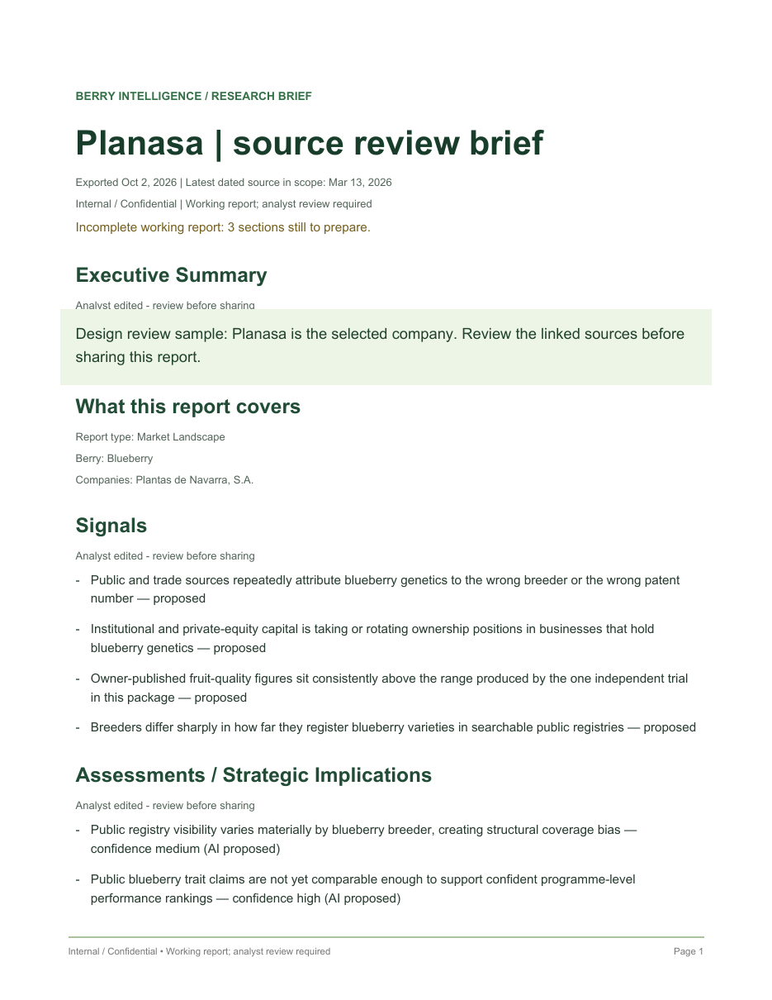
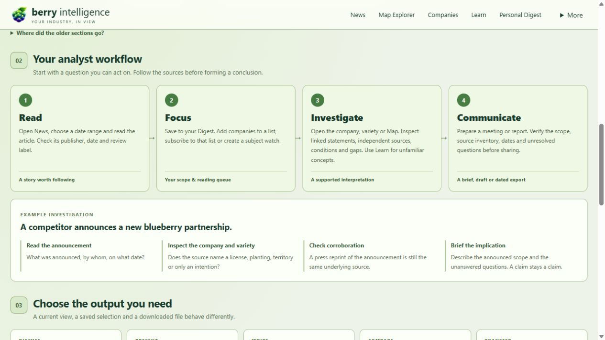
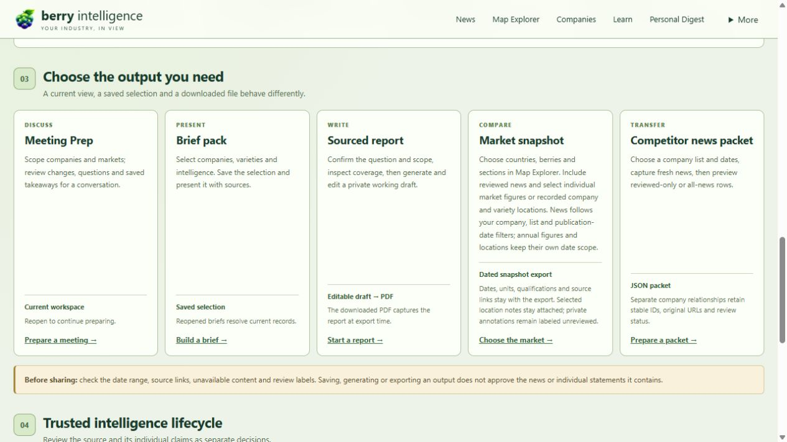
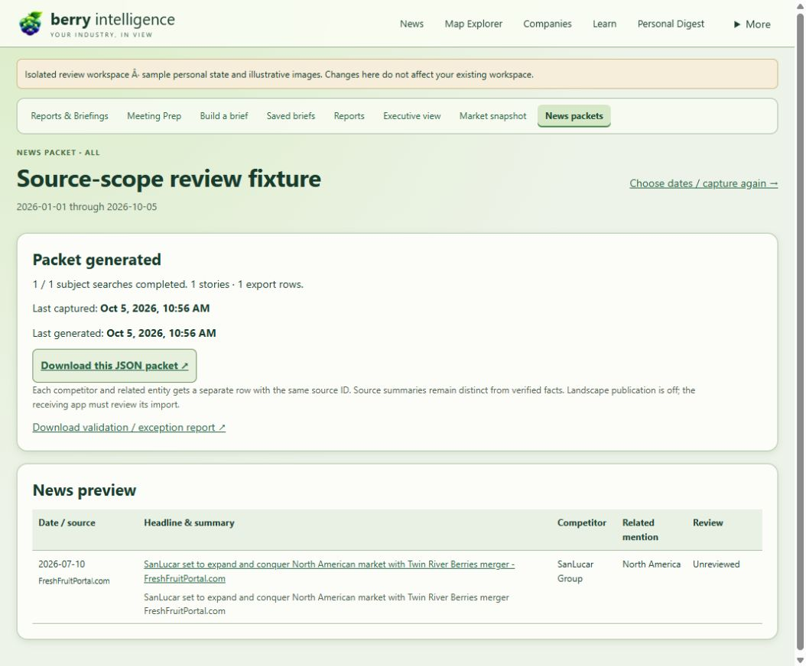

# Berry Intelligence release review

## Verified delivery status — October 21, 2026

The production deployment receipt identifies canonical `219c739a3ce621deb9c61d5db358ad7e8a087c20`
and image `sha256:dbe587a37a65e430bdb00959fc930d8b5f5e0ddad86fa543655933c81306421c`.
This includes the released platform redesign, News/access #401, subsequent
reader fixes, automatic News #404 and Gene Editing #406. Historical pending
release statements below must not be read as current deployment status.

Chris.H is enabled in the existing live account store. The originally requested
password was verified against the live account without signing in or changing
his account. First login is still pending and will open Help at `/guide`.
The analyst workspace is shared; separate logins do not provide per-user data
isolation. No password or password hash is included in this document.

The protected [mobile source-name worksheet](https://intel.johnnyaceii.com/review-preview/start.html)
is hosted as an isolated read-only service through the existing site login.
It includes all 52 retained sources. Source text, capture fingerprints and
blank review fields were preserved. Answers remain in the reviewer's browser
and can be downloaded; phone and PC answers do not synchronize automatically.
Publishing the worksheet did not complete source, name, identity or catalog review.

### Work still required

- Performance #405 is reconciled onto the current canonical release. Required
  checks on its new head, image rehearsal and release verification remain;
  the user authorized deploying the reviewed work on October 21. Its cache
  stores only bounded literal name transformations, never matching decisions.
- Catalog #399/#400 remains separate and undeployed. Its code must be reconciled
  and checked against the latest release; source, identity, catalog, Atomic,
  qualification and image-reuse decisions remain separate human gates.
- CAT-01/CAT-02 is unfinished: independent source-name answers, unresolved photo
  import cells, current/historical portfolio reconciliation, official rights,
  profile fields, attributed photos and source-backed growing regions remain.
  Bounded candidate discovery is not a globally complete variety database.
- Market-statistics controls and research exist, but broad country/berry content
  and individual source/figure approvals remain. Learn provides visual lessons
  and explicit research drafts, not verified rich media for every possible topic.
- TD-122 retains oversized candidate pages, repeated discovery scans and wider
  route/mobile contention. Source-access failures must stay explicit.
- Older draft PRs include stacked or already-released work. Open-PR count is
  not an unfinished-feature count; reconcile each before retiring duplicates.

The visual guide at `/guide` describes twelve sections, four analyst workflow
steps and six reporting outputs, including the separate variety review path.
All 31 accepted requirement IDs/descriptions remain in the durable checklist.
The entire mission remains open; this software release does not approve research.

## Dated implementation and release history

The following sections retain original evidence and earlier states. The verified
status above takes precedence where a historical release statement is superseded.

### Historical release audit — October 13, 2026 (superseded)

The platform features were released independently of ongoing catalog research.
[#398](https://github.com/samsonFive/berry-intelligence-os/pull/398) merged at
`a2a6b4adc8ab5409d0675f1435ca3bb3dbe276bc`. Its exact tested `1fb75b61` tree
is deployed at intel.johnnyaceii.com. All four checks passed, including 5,023
tests. Production-data rehearsal covered 17 authenticated routes and 12 exports;
final live checks covered seven main routes and all four Landscape formats.
14,057 existing files and all 3,933 social rows/schema were preserved. The final
14,060-file backup and previous image/configuration remain available for rollback.
A fresh read-only image inspection still confirms the released image is running.

[#401](https://github.com/samsonFive/berry-intelligence-os/pull/401), head
`8739a6c3`, is a separate tested candidate with all four checks and 5,030 tests
passed. New analyst login/first-login Help, one-click News refresh, safe reader
fallbacks and immediate News performance fixes await user release approval.
The requested account is staged privately and is not live. A new account grants
existing shared analyst access; it does not imply private preferences or roles.

Catalog [#400](https://github.com/samsonFive/berry-intelligence-os/pull/400) stays
a separate draft. Earlier head `1d7e17bc` passed all four checks; the original-paper
supplement `1dd38525` has three checks passed with Python validation running.
Required checks must be green on the eventual current head. No original-source,
identity, catalog, Atomic, extraction-qualification or photo gate is approved by
CI or by this document. Blueberry continuation was explicitly approved October 12.

### Accepted scope and remaining work

The [requirements checklist](REDESIGN-REQUIREMENTS-CHECKLIST.md) preserves every
one of the 31 original IDs, accepted descriptions and their ordering.

| Requirement family | Delivered software and evidence | Remaining work or limit |
| --- | --- | --- |
| UI-01–03, NEWS-01–03 | Shared Glasshouse shell, dense News/grid, images and reader; dated native desktop/mobile checks and current release suite | Existing source text stays literal; missing original text and inaccessible publishers remain explicit. Reader reliability improvements in #401 await release. |
| DIGEST-01, CO-01–02 | Digest/reading queue/subscribed lists, A–Z companies, independent favorites/tiers/lists, editable profiles and company-only People | Shared analyst state remains; no per-user isolation is claimed. |
| VAR-01–02, MAP-01–02 | Photo import review, region authoring/prefill, country map, dense A–Z region tables, cited statistics/research and exports | Unclear photo cells, provisional associations and source-backed content require human decisions; a country entry is not a confirmed acreage or growing footprint. |
| PACK-01–03 | Live 77-subject list; versioned packet schema, reviewed/all toggle, date range, export history and required fresh capture | Capture errors stay visible. Export freshness does not guarantee every publisher has new news or accessible full text. |
| AUDIT-01, INT-01, MON-01, OPS-01 | Section/workflow inventory and consolidated task homes preserve specialist routes and distinct review actions | Actual publication, statement, signal and source-authenticity decisions remain separate human work. |
| REPORT-01–03, LAND-01–02 | Reports/Meeting Prep, customizable four-crop Landscape, comparison, saved views and complete cited PDF/HTML/SVG/CSV outputs | Source/catalog completeness is separate from the released platform. No unreviewed mention is promoted into a verified trait or role. |
| LEARN-01–02 | Visual/interactive Learn plus selected-text research, cited editable drafts and retained origin; deterministic provider-contract tests | Fresh paid research requires explicit initiation and available provider access. Learn does not create Facts automatically. |
| GUIDE-01 | Live `/guide` explains twelve sections, four analyst steps, six reporting outputs and the separate variety workflow | Guide describes capability limits; it does not certify every live provider or every source. |
| CAT-01–02 | Source-to-variety discovery, original references, review/intake, profile-field coverage and preserved decisions | Current/historical coverage, 52 pending source artifacts, 32 independent worksheets, identity/catalog authoring, current rights and missing profile fields remain open. |
| REL-01 | #398 deployed with exact-tree verification, backup, preservation and rollback evidence | #401 and catalog enrichment require their own release approvals and current-head checks. |

The independent expected-name worksheet must be filled from the original sources
by a real reviewer, without using parser results as its answer key. Source fidelity
approval does not approve an identity, catalog record, statement or extraction
model. The current bounded 427-section inventory is not an internet-wide census.
No claim of global or web-leading completeness is supported.

The original 32-case worksheet no longer covers the 52-source reviewer copy;
the scorer correctly refuses a shortened source list. A fresh private worksheet
now includes all 52 exact captured sources and points to the current isolated
reader. All answers are blank. The original 32 cases and their capture hashes
remain preserved, and all 332 protected files still match the prior backup.
This packet is predominantly blueberry-focused; it is not proof of independent
four-crop recall or permission to skip any source/identity gate.

The detailed reviews below are preserved dated history. Their earlier pending
deployment and blueberry-gate statements do not supersede the current state above.

## Combined release on current canonical — October 13, 2026

The complete Landscape/source/catalog review changes are reconciled onto
canonical `642bc55657bb2b2e15c0d50bd72dd4686bbca4d3`, including the merged manual
Social Listening controls. The fourteen existing feature commits replay cleanly;
the Social Listening service/routes/assets/templates, manual pipeline settings,
deployment configuration and tests remain identical to canonical. The pinned
`langid` dependency is retained alongside the existing streaming dependency.
The governing expansion guide and all 31 requirement IDs/order are preserved.

This combined release needs fresh exact-head CI, browser review and isolated
host verification. Earlier source/Landscape checks are dated component evidence,
not a substitute. See [the reconciliation review](CANONICAL-RELEASE-INTEGRATION-REVIEW.md).
CAT-01/CAT-02 and human source/identity/catalog/qualification/photo gates remain
open. The tested software milestone does not imply a globally complete database.
Production merge and deployment remain separate approval steps.

## Current child draft #398 — October 13, 2026

The source-disclosure capture release at f93aa702 passes all four required
checks (4,972 passed / 11 skipped / two existing warnings) and the isolated
authenticated host, export, restart, backup/restore and prior-image rehearsal.
The subsequent labelled-list detector repair has 21 passing synthetic
parser/integration tests and native desktop/412px review. On an unchanged pending
source copy it finds 23 printed entries instead of zero, without approving any
source or variety. This later change needs its own fresh pushed-head checks and
release package verification. See [the bounded source review](PUBLISHER-DISCLOSURE-SOURCE-REVIEW.md).
All 31 requirements remain; CAT-01/CAT-02 and independent human review are open.
No merge or production deployment is authorized by these results.

## Current draft #396 — October 13 UTC, 2026

Landscape now supports all four existing crops, All berries and two-crop
comparison while keeping genetics and source status distinct. Shared company
favorites, tiers and lists scope every view/export; saved selections use the
existing revision-checked private store. PDF, HTML, SVG and CSV retain the full
selected evidence even when the portrait is bounded. Existing cited traits
retain their source, conditions, units and limitations. The updated `/guide`
explains twelve sections, four workflow steps and six reporting choices.

The private variety workflow exposes source-named gaps, persistent alphabet
navigation, attributable photo references and original patent/PVR click-throughs.
Recent original register rechecks distinguish applications/grants and reported
statuses, grouping repeated captures while retaining every earlier URL/date and
status change. No source wording approves a variety, alias, company role, growing
region, current right or photo permission. All 31 requirements are retained in
[the durable checklist](REDESIGN-REQUIREMENTS-CHECKLIST.md).

Review on this PC: [Landscape](http://127.0.0.1:18580/landscapes/explorer),
[coverage](http://127.0.0.1:18580/varieties/coverage#profile-field-coverage),
[candidate review](http://127.0.0.1:18580/varieties/candidates) and
[the visual explainer](http://127.0.0.1:18580/guide). This is an isolated recovered
runtime with collection disabled. It does not overwrite production or the
original review workspace. These loopback links are for this PC, not mobile.

### Verification and recovery

- Application/package head: `ec80d8afdb6dbc1558c05d292d250d03296c3c24`;
  branch `feature/blueberry-catalog-release-review`;
  reconciled canonical `7360c5821c009484381394ed8afa9fb91e322a50`.
- Exact committed package: 3,679 verified files, SHA-256
  `cd5fdb199d052b97d348fe5eee0e192a40c16639f135af669eaac4409aef82e6`.
- Separate authenticated loopback host review: fifteen sections, twelve
  crop/format exports, Cargo's distinct applications and older capture history,
  restart with marks/list/edit retained, 2,961-file empty-target recovery and
  previous-production-image rollback. All 32 pending source copies and the
  original draft remain protected. No provider collection calls or human
  review decisions were made by this rehearsal.
- Fresh actual production backup: 14,051 files hash-verified, process lease
  excluded; available prior image and configuration recorded privately.
  Production container/configuration did not change or restart.
- ec80 full CI: three required checks passed; Python had one historical
  replay-test corpus boundary failure, 4,954 passed / 11 skipped / two warnings.
  Forty corrected replay/portfolio/reference tests pass locally. Fresh exact-head
  Change scope, Repository integrity, Static public safety and Python tests
  remain required. Prior 45e5c60a all-green / 4,951 is dated evidence only.
- Native desktop and 412px emulation covered comparison, applied saved scope,
  company filters, complete downloads, guide and original references. Current
  Cargo phone document/scroll widths are both 397px; emulation was reset.
  This is not a physical-phone test.
- Local All-berries requests: 1.262s cold, 0.228/0.223s warm, 1,563,094-byte HTML;
  Blueberry/Strawberry 0.949s cold, 0.229/0.342s warm, 1,320,430 bytes;
  Raspberry/Blackberry 0.452s cold, 0.181/0.201s warm, 942,912 bytes.
  Native All controller setup 1.70ms; Kwanza/Advanced Berry Breeding highlights
  5.40/10.20ms. Server and controller timings exclude complete transfer/paint
  latency; they do not prove an end-to-end two-second budget.

### Remaining work and release boundary

The catalog still has 64 canonical varieties. The bounded portfolio audit has
395 sections / 1,572 occurrences / 102 matches / 1,470 requiring review, including
repeated captures. Fourteen supplied subjects have partial lists, one has
unavailable sources and two have identity holds. Source-body acquisition,
full current/historical portfolios, current legal verification, missing profile
fields and independent human recall remain; 32 expected-name worksheets are
unfinished. No global completeness or web-leading claim is supported.

The user approved blueberry continuation and local review downloads. No routine
checkpoint pause is needed. Final release review, merge and production deployment
remain separate. Before an approved deployment, reconcile the exact base/head,
verify a fresh production backup and available rollback image/configuration,
preserve persistent edits/data and one worker, then check login and selected
workflows. Revert the image for an application regression; restore data only
for an actual data regression. No merge or deployment occurred here.

## Historical accepted redesign — October 6, 2026

The approved redesign/consolidation was integrated through
[PR #312](https://github.com/samsonFive/berry-intelligence-os/pull/312).
The following evidence describes that historical release, not the current draft.

## News imagery correction after desktop review

The retained first news page originally had no collected thumbnails. News, Personal Digest and both Reader modes now share publisher-first visuals with the four approved crop illustrations as explicitly labeled fallbacks, including failed image loads. Illustrations are display-only; they never become source metadata or evidence. WebP delivery reduces the four fallback assets from about 10.3 MB to 0.89 MB without changing their composition or dimensions. **Load article images** checks at most the 36 stories in the current scope; explicit news refresh also fills missing images for newly captured stories. Browsing remains read-only, and captured image metadata is bound to the original source ID/URL.

The isolated native first-page check completed: 36 checked, two publisher thumbnails found; a real FreshFruitPortal photograph loaded in both the feed and Reader. Opaque Google News wrappers and unavailable publisher photos retain labeled illustrations. Existing source records, trust decisions and user edits were not changed. A Windows reader/file-lock failure was reproduced and corrected with a bounded atomic-write retry; persistent failure preserves the original file. Required current-head CI still gates merge/deployment.

## What to review

Start with News and its right-side Reader, then Companies, Map Explorer and Personal Digest. The agricultural Glasshouse shell, contained More menu and shared marks/lists are the accepted direction. Review the takeaway-first report below and open **How it works** in More for the visual section/workflow/reporting guide. This is a working report sample, not a verified market conclusion.

## Final acceptance added October 5

A real one-company SanLucar watchlist capture used public Google News RSS, with January 1 through October 5 selected in the native form. The initial local-network restriction produced a failed capture and no export. After restarting only the isolated server with permitted network access, both independent captures completed: 17 discovered results, three qualifying hits before date/match selection. All-news produced one unreviewed export row; Reviewed-only produced zero. Empty reviewed coverage was not filled with a fresh unreviewed source.

The actual browser downloaded both JSON packets; schema validation passed. All-news recorded `2026-10-05T17:56:32Z`; Reviewed-only recorded `2026-10-05T17:57:47Z`. Re-download retained the first receipt. Last generated showed the later successful export. All seven packet history/job/capture files remained byte-identical after the isolated server restarted, and the native history still showed both exports. No source, statement or identity was approved. Original Google wrapper URLs stayed unchanged; Landscape publication stayed false. This one-subject probe proves the adapter/workflow, not comprehensive capture of all 77 competitors.

United States + Blueberry + the same list retained scope between Map, News and snapshot. The company-region table correctly had no records for that selected company; news mentions did not create operating regions. The native snapshot PDF retained **761 million lb** utilized production and **104,700 acres** harvested area for cultivated blueberries, 2025, with USDA page 75 and May 1 publication date. Both rendered pages were inspected. Its zero selected trusted-news count stays explicit. [Scoped snapshot sample](../../artifacts/design-sprint/release-snapshot-native.pdf).

Map and snapshot phone pages measured 375px inside a 390px viewport; the temporary override was reset. Packet columns now reserve readable source/review space, with wide content scrolling inside the phone table rather than widening the page. [Map phone](../../artifacts/design-sprint/release-map-phone.png) · [Snapshot phone](../../artifacts/design-sprint/release-snapshot-phone.png).

## Accepted-requirement audit

Every accepted requirement is accounted for below. Evidence distinguishes native actions, deterministic regressions, actual public captures and human-owned decisions. Existing mission reports retain earlier failures and their corrections; historical “remaining” notes are superseded by this final audit only for the named delivered work. The suite paths below exist in the current candidate and are included in required full CI.

| ID | Delivered purpose | Evidence and regression suite | Acceptance / limit |
| --- | --- | --- | --- |
| UI-01 | Agricultural Glasshouse identity and first berry icon | [MISSION-35-RETAINED-WORKSPACE-SHELL](MISSION-35-RETAINED-WORKSPACE-SHELL.md); [regressions](../../tests/test_retained_workspace_shell.py) | Desktop/phone shell evidence in M21/35; current guide and Map screenshots. |
| UI-02 | Full-width navigation and contained grouped More menu | [MISSION-35-RETAINED-WORKSPACE-SHELL](MISSION-35-RETAINED-WORKSPACE-SHELL.md); [regressions](../../tests/test_retained_workspace_shell.py) | Eleven consolidated homes; compatibility and specialist links retained. |
| UI-03 | Headline, lead, body and secondary-context hierarchy | [REPORT-READING-DESIGN-FOLLOWUP](REPORT-READING-DESIGN-FOLLOWUP.md); [regressions](../../tests/test_report_export_readability.py) | Five report PDF pages inspected; source/analyst wording preserved. |
| NEWS-01 | Newest-first, images, dates and multi-select filters | [MISSION-31-COMPACT-NEWS-AND-CAPTURE-BOUNDS](MISSION-31-COMPACT-NEWS-AND-CAPTURE-BOUNDS.md); [regressions](../../tests/test_news_workspace.py) | M29-31 source/date/phone acceptance; M37 conservative company recall. |
| NEWS-02 | Trusted/raw lanes and accessible feedback/save/source actions | [MISSION-03-NEWS-READER](MISSION-03-NEWS-READER.md); [regressions](../../tests/test_feed_first_acceptance.py) | Source review remains distinct from feedback and individual statements. |
| NEWS-03 | Overlay Reader, original content and publisher handoff | [MISSION-30-READER-PREVIEW-CONTINUITY](MISSION-30-READER-PREVIEW-CONTINUITY.md); [regressions](../../tests/test_feed_first_reader.py) | One real article: nine readable paragraphs/eight image references; unavailable content is explicit. |
| DIGEST-01 | Saved, reading queue and subscribed lists | [MISSION-37-CONSOLIDATION-RELEASE-AUDIT](MISSION-37-CONSOLIDATION-RELEASE-AUDIT.md); [regressions](../../tests/test_personal_digest.py) | Five real SanLucar source mentions matched News/Digest; shared personal state survived container restart/recovery. |
| CO-01 | Alphabet, favorites, independent tiers and lists | [MISSION-18-COMPANY-TRACKING-ACCEPTANCE](MISSION-18-COMPANY-TRACKING-ACCEPTANCE.md); [regressions](../../tests/test_company_directory.py) | Cross-view scope tests plus authenticated persisted favorite/tier/list. |
| CO-02 | Editable logo/links and company-only People | [MISSION-38-RELEASE-REHEARSAL](MISSION-38-RELEASE-REHEARSAL.md); [regressions](../../tests/test_company_profile_research.py) | Native chooser/upload/save/reset; protected individual research and edit/history tests. |
| VAR-01 | Supplied photo varieties associated with supplied companies | [MISSION-06-VARIETIES](MISSION-06-VARIETIES.md); [regressions](../../tests/test_operator_variety_seed.py) | 143 candidates/144 associations/32 unclear cells retained. Human identity/role decisions stay open. |
| VAR-02 | Growing/operating regions with source-assisted edits | [MISSION-27-SOURCE-LOCATION-SUGGESTIONS](MISSION-27-SOURCE-LOCATION-SUGGESTIONS.md); [regressions](../../tests/test_region_source_research.py) | Native isolated corrected company/variety locations reached shared Map; no inferred footprints. |
| MAP-01 | Country boundaries, shared scope and alphabetic region tables | [MISSION-29-SNAPSHOT-NEWS-SCOPE](MISSION-29-SNAPSHOT-NEWS-SCOPE.md); [regressions](../../tests/test_global_explorer.py) | Current native United States/Blueberry/list scope retained into News/snapshot; phone page 375px in 390px viewport. |
| MAP-02 | Sourced statistics and explicit research population | [MISSION-36-MARKET-REFERENCE-RESEARCH](MISSION-36-MARKET-REFERENCE-RESEARCH.md); [regressions](../../tests/test_market_reference_research.py) | USDA/Eurostat units and flags; real national research remains unapplied; current native/PDF original units checked. |
| PACK-01 | 77 supplied subjects, versioned schema and separate rows | [MISSION-02-COMPETITOR-NEWS-PACKETS](MISSION-02-COMPETITOR-NEWS-PACKETS.md); [regressions](../../tests/test_competitor_news_packets.py) | Real database identity test and unchanged-URL/separate-relationship-row regression; provisional identities disclosed. |
| PACK-02 | Reviewed-only/all, dates and successful export history | [MISSION-38-RELEASE-REHEARSAL](MISSION-38-RELEASE-REHEARSAL.md); [regressions](../../tests/test_competitor_news_packets.py) | Current native real capture: All=1 row, Reviewed=0; both schema-valid downloads/receipt times; seven persisted files byte-identical after restart. |
| PACK-03 | Fresh capture before generation; real failure and retry | [MISSION-38-RELEASE-REHEARSAL](MISSION-38-RELEASE-REHEARSAL.md); [regressions](../../tests/test_competitor_news_packets.py) | Actual blocked capture refused export; permitted retry found 17 hits; freshness/schema/idempotency failures tested. |
| AUDIT-01 | Purpose, working state, consolidation and retained workflows | [APP-SECTION-AUDIT](APP-SECTION-AUDIT.md); [regressions](../../tests/test_retained_workspace_shell.py) | Accepted eleven-home structure, retained routes; M37 audited ten historical PRs including all 868 paths in #253. |
| REPORT-01 | One home with distinct report/brief/snapshot/packet outputs | [MISSION-07-REPORTS-BRIEFINGS](MISSION-07-REPORTS-BRIEFINGS.md); [regressions](../../tests/test_briefings_workspace.py) | Native brief save/reopen/duplicate/presentation and edited report/PDF, plus current native snapshot/packet. |
| REPORT-02 | Meeting Prep scope, takeaways and handoffs | [MISSION-07-REPORTS-BRIEFINGS](MISSION-07-REPORTS-BRIEFINGS.md); [regressions](../../tests/test_briefings_workspace.py) | Native scoped takeaway persistence and handoff; deliberate research only; pure reads/error guards tested. |
| REPORT-03 | Takeaway-first designed reports with readable references | [REPORT-READING-DESIGN-FOLLOWUP](REPORT-READING-DESIGN-FOLLOWUP.md); [regressions](../../tests/test_report_export_readability.py) | Original critique corrected: numbered findings, plain source references, all five PDF pages and phone inspected. |
| LAND-01 | Customizable competitive Landscape | [MISSION-08-CUSTOMIZABLE-LANDSCAPE](MISSION-08-CUSTOMIZABLE-LANDSCAPE.md); [regressions](../../tests/test_landscape_workspace.py) | Saved private what/where/date/section scope, handoffs and read-only/provider boundaries tested/reviewed. |
| LEARN-01 | Top-level detailed visual Learn | [MISSION-19-LEARN-TEACHING-VISUALS](MISSION-19-LEARN-TEACHING-VISUALS.md); [regressions](../../tests/test_learn_teaching_visuals.py) | Five-pillar teaching diagrams, licensed image and source/video links; knowledge classes retained. |
| LEARN-02 | Selection to explicit deep research and editable lesson | [MISSION-09-VISUAL-LEARN](MISSION-09-VISUAL-LEARN.md); [regressions](../../tests/test_learn_research.py) | One actual 42-source research; native existing-lesson detour/save/reload; durable uncertain-run recovery without resubmission. |
| INT-01 | Plain-language investigation and retained human decisions | [MISSION-17-INTELLIGENCE-AUTHORING](MISSION-17-INTELLIGENCE-AUTHORING.md); [regressions](../../tests/test_intelligence_authoring_workspace.py) | M12-17/34/35 native review/authoring/history; original passages and per-proposition gates retained. |
| MON-01 | Watches, changes, alerts and monitoring plans together | [MISSION-10-MONITOR-OPERATIONS](MISSION-10-MONITOR-OPERATIONS.md); [regressions](../../tests/test_monitor_consolidation.py) | Native read/reopen, dismiss/reopen, pause/reload/resume; durable history/corruption and origin tests. |
| OPS-01 | Collection, review, data quality and coverage together | [MISSION-34-SOURCE-AUTHENTICITY-WORKSPACE](MISSION-34-SOURCE-AUTHENTICITY-WORKSPACE.md); [regressions](../../tests/test_review_operations.py) | Native separate fidelity gate/refusal/advance/history; no collection on browse; retained specialists. |
| GUIDE-01 | Visual section/workflow/reporting explainer | [MISSION-38-RELEASE-REHEARSAL](MISSION-38-RELEASE-REHEARSAL.md); [regressions](../../tests/test_guided_analyst_experience_v1.py) | Current desktop and phone: eleven purpose cards, four steps, worked example, five outputs and separate review lifecycle. |
| REL-01 | Canonical reconciliation, tested release and safe recovery | [MISSION-38-RELEASE-REHEARSAL](MISSION-38-RELEASE-REHEARSAL.md); [regressions](../../tests/test_runtime_backup.py) | Authenticated isolated exact-head container, 2,798-file verified restore/prior-image rollback, unchanged production; final PR checks required. |

Final focused packet, Briefings and Guide checks: **48 passed**, one existing ReportLab warning, 15.30 seconds.

## Deliberate limits and human decisions

- Photo spelling/identity/company-role exceptions and ambiguous source identities remain review items. The import seeds candidates; it does not assert ownership or merge uncertain identities.
- Publisher access, article text, images and national statistics remain source-dependent. Existing missing values/annual qualifications stay visible; more coverage and licensed lesson media are ongoing content work, not invented data.
- Research results are cited editable proposals. Publication, individual statement, source authenticity, market-figure acceptance and extraction qualification are separate human decisions. Feedback, saving, subscriptions and report generation do not perform them.
- The supported deployment is one shared analyst workspace with one application worker. Separate user-account state, distributed writers and exact subnational polygons are later scope. Provider configuration/readiness is checked without enabling recurring collection/extraction or copying keys into review artifacts.
- Original private user edits/history and existing runtime records are preserved. No historical draft PR was merged, closed or applied wholesale. Canonical expansion-guide content remains verbatim.

## Release and rollback readiness

Required checks passed on application/package head `60d6f0f8208db3b39d1ac9c7ca8322bbea87bffe`: 3,895 passed / 11 skipped / two existing warnings, run [37349791854](https://github.com/samsonFive/berry-intelligence-os/actions/runs/37349791854). This final acceptance update also changes packet presentation, so its pushed head requires fresh checks. The PR must show successful **Change scope**, **Repository integrity**, **Static public safety** and **Python tests** before approval.

The prior exact committed 3,471-file package ran as a separate authenticated, loopback-only container on the existing trusted host. Twelve core routes loaded. Favorite/tier/list and an edited existing company record survived restart. A verified 2,798-file backup restored byte-for-byte into a new empty target; the previous production image ran against an isolated restored copy. Live container ID/image/start/mounts stayed unchanged. The final candidate is packaged with committed-byte/executable-mode verification; final identity, hash, container smoke and CI are recorded in PR #312 after push. See [rehearsal and deployment sequence](MISSION-38-RELEASE-REHEARSAL.md).

After final human approval, deployment must first verify a fresh consistent backup of the actual production data/inbox and record its previous image/configuration. Keep the existing authenticated persistent mounts and one worker; deploy code without replacing user data. Verify login, core workflows and selected operator state. Revert the image on an application regression; restore data only for an actual data regression under the documented safe recovery procedure. The test backup does not replace a production backup.

No additional user interview is needed to review this candidate. Merge and live deployment remain the explicit final approval boundary.
