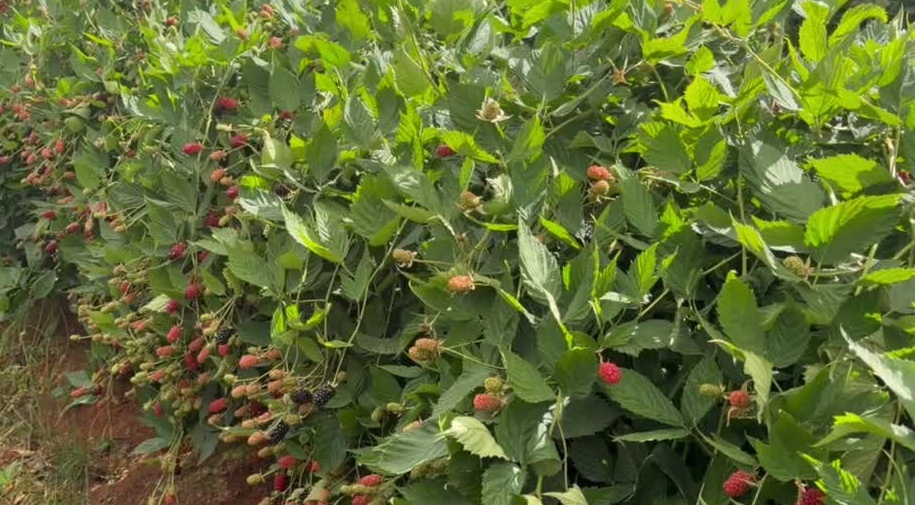

# Regina blackberry

### Variety and commercial profile · 13 November 2026

**Regina is a blackberry promoted by Black Venture Farm (BVF), part of Frutura’s Sun Belle berry business, with reported cultivation in Michoacán, Mexico. Public communications describe floricane fruiting and emphasize fruit quality; formal cultivar identity, rights, measured performance, and commercial scale remain unresolved.** [1,2,3,4,5,7][R01]

- **Public footprint:** BVF’s 29 April 2026 field publication names Regina and Aketzali in Tocumbo. A separate plant offer includes Regina; neither establishes a launch date, acreage, or current stock. [1,2][R01]
- **A separate raspberry bears the same name.** Regina records associated with Ilario Ioriatti and Berryplant concern raspberry and do not establish the blackberry’s identity or traits. [14][R14]

## Evidence position

| Topic | Position | Basis |
|---|---|---|
| Commercial name and offer | Regina appears in BVF’s plant promotion. | Documented publication; stock availability unconfirmed. [2][R02] |
| Production and location | BVF reports cultivation in Tocumbo, Michoacán. Los Reyes is the location of Sun Belle associated promotion, not a separately verified farm. | Reported. Destinations are unknown. [1,3][R01] |
| Fruiting and developer | Floricane fruiting and BVF development/ownership are described in an industry post. | Reported; technical sheet and corresponding rights record not identified. [4][R04] |
| Product proposition | Promotion emphasizes flavor, firmness, and appearance. | Marketing claims, not measured superiority. [3][R03] |
| Identity, rights, and performance | Formal denomination, parentage, licensing terms, thorn status, harvest window, yield, berry specifications, disease response, and shelf life are not established. | Unknown. |
| Scale and adoption | Quantified area, a named grower base, sales history, and a Regina-specific retail program are not identified. | Unknown. |

[][R01]

*[Watch the field video][R01] · BVF’s 29 April 2026 publication discusses Regina and Aketzali. The cultivar in this frame is not identified.*

<!-- page -->

## An integrated commercial platform

**Black Venture Farm combines breeding, propagation, and grower support within Frutura’s integrated Sun Belle berry business.**

The Giddings acquisition was **announced in October 2023 and completed in 2024**. Frutura’s sustainability report dates Giddings’ formal entry into the group to **October 2024**. At announcement, BVF was Giddings’ wholly owned Mexican breeding subsidiary. [6,8,15][R06]

In December 2024, Frutura consolidated its berry operations under the Sun Belle brand and renamed the Mexican operations Sun Belle Mexico. Contemporary coverage identifies BVF as a wholly owned subsidiary of Sun Belle Mexico. The current Frutura portfolio confirms BVF’s breeding/propagation role and Sun Belle’s marketing role. [5,7][R05]

| Business capability | Existing role |
|---|---|
| BVF | Breeding, nursery propagation, and technical support for growers. |
| Mexican growing operations | Production within the Sun Belle Mexico business. |
| Sun Belle | Berry marketing and distribution to North American and international customers. |

The group has an established breeding-to-market network. The reviewed sources do not identify a Regina-specific buyer program, destination market, exclusivity arrangement, or retail listing.

## Identity, breeding, and rights

**Regina is documented as a commercial name; its legal denomination or selection code has not been established.** An industry post attributes development/ownership to BVF. Breeding location and country of origin, parentage, selection history, and introduction date are undocumented in the reviewed material. Mexican cultivation does not by itself establish Mexican breeding origin. [2,4][R02]

An exact-name CPVO search on 12 November 2026 returned eight records and no blackberry match; its only *Rubus* result was raspberry. This search does not exclude protection under another denomination or in another jurisdiction. Regina-specific patents, variety rights, license territories, royalties, and exclusivity remain unidentified. [16][R16]

**Aketzali holds an issued USDA plant variety protection certificate, dated 4 June 2021** (certificate 202000246). This documents protection for another BVF blackberry; it does not identify Regina’s rights. [9][R09]

### Agronomic and fruit information

| Attribute | Publicly available detail |
|---|---|
| Fruiting habit | Floricane, reported in an industry post; no breeder technical sheet identified. [4][R04] |
| Plant and season | Thorn status, vigor, growth habit, yield, harvest window, disease response, and climate adaptation are undocumented. |
| Fruit and postharvest | Flavor, firmness, and appearance are promoted. Berry weight, dimensions, Brix, acidity, measured firmness, shelf life, and shipping results are unavailable. [3][R03] |

<!-- page -->

## Commercial comparisons

The comparisons cover BVF’s existing portfolio, proprietary Mexican-market programs, and a Brazilian agronomic reference.

| Variety / program | Commercial context | Production or product focus |
|---|---|---|
| **Regina — BVF** | Public plant offer and reported Michoacán cultivation; destination program unidentified. | Reported floricane; quality promoted without a published specification. [1,2,3,4][R01] |
| **Aketzali — BVF / Sun Belle** | Issued US protection; Sun Belle identifies Mexican production. | Established same-platform blackberry with an official variety description in its protection dossier. [9,10][R09] |
| **Tupy — Embrapa** | Brazilian breeding and cultivation reference in Embrapa’s guide. | Erect, vigorous, thorned. The cited description concerns Brazilian conditions. [11][R11] |
| **Black Sultana — Planasa** | Listed in Planasa’s Mexican catalog. | Primocane variety promoted for flexible production, fruit quality, and shelf life. [12][R12] |
| **Sweet Karoline — Berry Fresh** | Berry Fresh identifies Jalisco production and a November–June harvest. | Exclusive breeding program marketed around sweetness and retail differentiation; fruiting habit not specified on the cited product page. [13][R13] |

No direct trial comparing Regina with these varieties was identified in the reviewed sources. The table describes commercial alternatives and positioning, not a performance ranking.

## Questions for further investigation

The following questions define the information still missing from Regina’s public profile.

| Research area | Open questions | Relevant records or data |
|---|---|---|
| **Identity and access** | What legal denomination/code corresponds to Regina? Who bred it and holds rights? Where and on what terms is it available? | Breeder description, authenticated plant labels, registry filings, and license terms. |
| **Production** | What are its harvest window, saleable yield, picking cost, and response to local climates and diseases? | Identity-linked trials and farm records, with location, season, crop age, and management specified. |
| **Fruit and shipping** | What size, flavor, firmness, shelf life, and arrival quality does it deliver? | Fruit specifications, sensory results, and shipment trials with handling conditions and any controls identified. |
| **Commercial footprint** | Which farms, nurseries, buyers, and retailers handle Regina? What area, volumes, destinations, and adoption trend are documented? | Dated planting and sales records, named programs, and cultivar-specific packaging or retail listings. |

The reviewed material establishes public promotion and reported field cultivation. It does not establish the scale or trajectory of commercialization, including expansion, decline, or discontinuation.

<!-- page -->

## Sources and research links

**Every numbered citation and source title is clickable.** Sources 1–4 cover Regina-specific statements; 5–8 and 15 cover the corporate platform; 9, 14, and 16 cover rights and identity; 10–13 provide comparisons.

1. [Black Venture Farm — Tocumbo field video][R01] · LinkedIn, 29 Apr 2026. **Read for:** Regina/Aketzali field attribution; the pictured cultivar is unspecified.
2. [BVF — plant-offer post reproduced in profile activity][R02] · LinkedIn, undated; captured 12 Nov 2026. **Read for:** Regina’s inclusion in a plant offer, not stock or license terms.
3. [Regina — fruit-quality promotion reproduced in profile activity][R03] · LinkedIn, undated; captured 12 Nov 2026. **Read for:** the Sun Belle associated quality claims; no measurements supplied.
4. [Regina — floricane/developer post reproduced in profile activity][R04] · LinkedIn, undated; captured 12 Nov 2026. **Read for:** the reported fruiting habit and BVF attribution; original technical document unavailable.
5. [Frutura — company portfolio][R05] · Official website, undated. **Read for:** current business roles of BVF and Sun Belle.
6. [Frutura — acquisition announcement and BVF/Giddings structure][R06] · FreshPlaza, 17 Oct 2023. **Read for:** signed agreements and BVF’s ownership at announcement.
7. [Sun Belle — consolidation and BVF subsidiary relationship][R07] · FreshPlaza, 11 Dec 2024. **Read for:** Sun Belle Mexico, group branding, and the stated BVF ownership chain.
8. [Frutura — 2024 Sustainability Report, relevant spread][R08] · Company report, 2025; opens PDF page 12, printed pp. 24–25. **Read for:** Giddings’ formal entry in October 2024.
9. [USDA — Aketzali certificate 202000246][R09] · Granted 4 Jun 2021; opens the certificate. **Read for:** issued protection, owner, denomination, and attached variety description.
10. [Sun Belle — blackberry portfolio][R10] · Official website, undated. **Read for:** Aketzali’s Mexican production; this is not a Regina listing.
11. [Embrapa — Cultivo de amoreira-preta][R11] · Dec 2007, printed p. 36. **Read for:** Tupy’s Brazilian agronomic description, not current Mexican adoption.
12. [Planasa Mexico — Black Sultana / Plablack 15157][R12] · Official catalog, undated. **Read for:** primocane positioning; numerical results are from Cartaya, Spain.
13. [Berry Fresh — Sweet Karoline][R13] · Official product page, undated. **Read for:** Jalisco production, November–June harvest, and branded positioning; sweetness figures are marketer claims.
14. [Bundessortenamt — Regina raspberry inventory][R14] · 2016; opens p. 48; address directory p. 68. **Read for:** the separate Ioriatti/Berryplant raspberry identity.
15. [Sun Belle / Frutura — leadership interview on the acquisitions][R15] · AndNowUKnow, 23 Apr 2026. **Read for:** confirmation that the Giddings/Sun Belle Mexico acquisition completed in 2024.
16. [CPVO — exact-name Regina search, record data][R16] · Queried 12 Nov 2026. **Read for:** the separate raspberry result; this exact-name search does not capture differently named or coded filings.

[R01]: https://es.linkedin.com/posts/black-venture-farm_bvf-gen%C3%A9ticabvf-campoorg%C3%A1nico-activity-7455251541965369344-d7fd
[R02]: https://mx.linkedin.com/in/karina-m-018730219
[R03]: https://mx.linkedin.com/in/mauricio-grajeda-0ba2a0200
[R04]: https://mx.linkedin.com/in/daniel-partida-baa7261aa
[R05]: https://www.fruturaproduce.com/companies/
[R06]: https://www.freshplaza.com/north-america/article/9568700/it-s-a-dream-come-true/
[R07]: https://www.freshplaza.com/north-america/article/9686892/berries-are-set-to-be-an-outsized-growth-story-we-re-highly-committed-to/
[R08]: https://www.daykahackett.com/wp-content/uploads/2025/11/Frutura_2024SustainabilityReport.pdf#page=12
[R09]: https://apps.ams.usda.gov/CMS/AdobeImages/202000246.pdf#page=1
[R10]: https://www.sunbelle.info/blackberries/13
[R11]: https://www.infoteca.cnptia.embrapa.br/infoteca/bitstream/doc/745965/1/Cultivo-de-amoreira-preta-2007-CPACT.pdf
[R12]: https://planasa.com/mx/variedad/black-sultana/
[R13]: https://berryfresh.com/sweet-karoline-blackberry/
[R14]: https://www.bundessortenamt.de/bsa/media/Files/BlfS/BlfS_Sonderheft/BlfS_Sonderheft_2016.pdf#page=48
[R15]: https://www.andnowuknow.com/whats-store/jc-clinard-taylor-hazelwood-and-more-discuss-company-evolution-25-years/chandler-james/104105
[R16]: https://online.plantvarieties.eu/api/publicSearch/v3/publicSearch?denomination=Regina&denominationSearchType=equals
